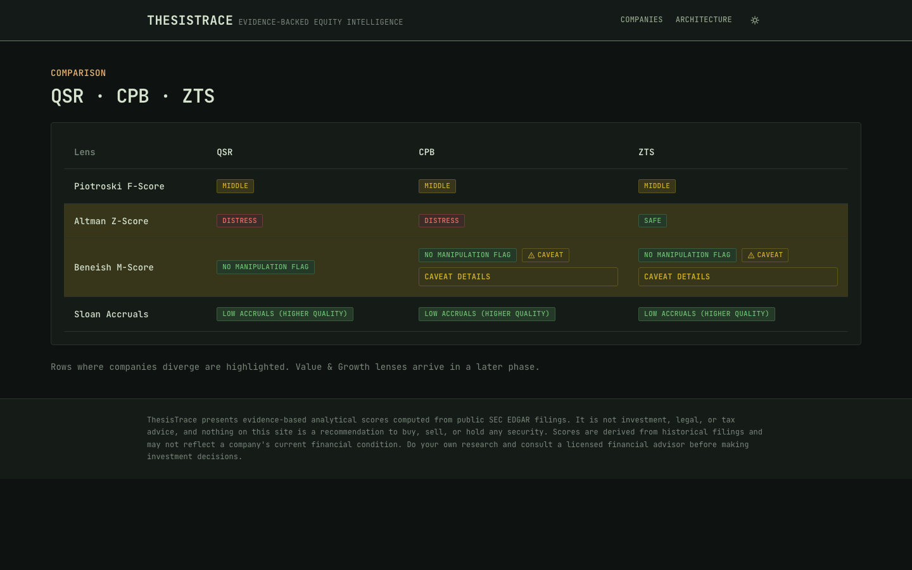
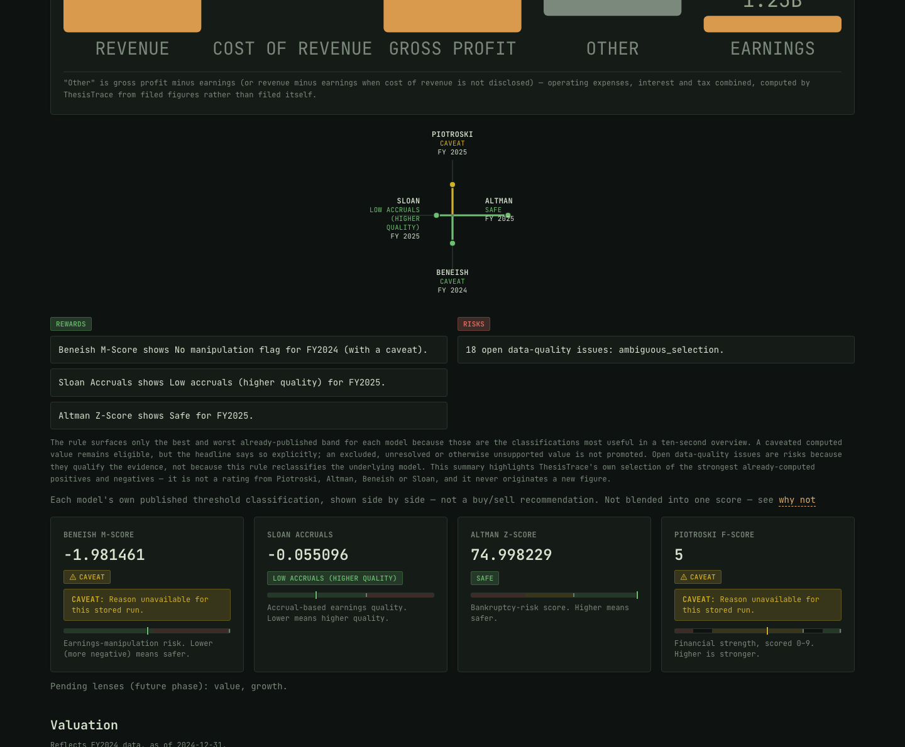
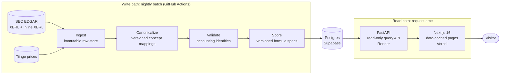

# ThesisTrace

**Forensic accounting scores for public companies, computed from SEC filings and traced back to the line item they came from.**

[**Live demo →** thesis-trace.vercel.app](https://thesis-trace.vercel.app) &nbsp;·&nbsp; [Architecture](#architecture) &nbsp;·&nbsp; [Methodology](https://thesis-trace.vercel.app/methodology/piotroski)

[](https://github.com/lawrence-dass/thesis-trace/actions/workflows/ci.yml)
[](https://github.com/lawrence-dass/thesis-trace/actions/workflows/pipeline.yml)



ThesisTrace reads a company's annual filings from SEC EDGAR and runs four well-known forensic models over them: **Piotroski F-Score** (financial strength), **Altman Z-Score** (bankruptcy risk), **Beneish M-Score** (earnings manipulation) and **Sloan accruals** (earnings quality). It adds a **reverse DCF** that asks what growth today's share price implies.

Every number is computed by deterministic code from filed XBRL data. An LLM never produces a score or a figure. Every input can be traced to the filing, accession number and XBRL concept it came from.

> Not investment advice. ThesisTrace shows what published models say about historical filings; it does not recommend buying or selling anything.

---

## Why it's built this way

Most "AI stock analysis" tools ask a language model for a number. ThesisTrace is built on the opposite premise: **financial figures must be reproducible and auditable, so they come from code, and the LLM is kept out of the numeric loop.**

| Principle | How it's enforced |
|---|---|
| **No LLM-invented numbers** | Scores are computed by a shared decimal engine from versioned formula specs. Explanations are generated by a deterministic template from stored results. An optional LLM layer (Claude Haiku) may only *reword* that text, behind a constraining prompt; the public site doesn't call it at all. |
| **Every figure has provenance** | Each displayed value resolves to `(accession number, XBRL concept, filing period, source)` end to end, from the database through the API to a citation chip in the UI. A value without resolvable provenance is not displayed as fact. |
| **Missing data is never a zero** | Every signal is `pass`, `fail` or `insufficient_data`. A missing input propagates as `insufficient_data` through scoring, API and UI. Nothing coerces it to a default that could flip a score. |
| **No floating point for money** | Every financial value is `NUMERIC`/`Decimal`, rounded by one enumerated policy (`ROUND_HALF_EVEN`). Two independent evaluators can't disagree at a threshold boundary because of float drift. |
| **Formulas are versioned artifacts** | Each model's equation, inputs, thresholds and missing-data policy lives in a versioned YAML spec (`piotroski_v1.yaml`, …). Every score run records the spec version it used. |
| **History is append-only** | Raw filings are immutable. When a company amends a filing (10-K/A), a new score run supersedes the old one; nothing is overwritten. |

These are recorded as 21 architecture decisions in the [architecture spine](./_bmad-output/planning-artifacts/architecture/architecture-ThesisTrace-2026-07-19/ARCHITECTURE-SPINE.md).

## What's in a report



- **Verdict overview**: each model's own published classification, shown side by side and deliberately not blended into one composite score.
- **Expandable breakdowns** of every sub-signal (all 9 Piotroski tests, all 8 Beneish indices, all 5 Altman components), each cited to its filing.
- **What changed** since the previous filing, and multi-year **trajectory** for each model.
- **Reverse DCF**: the revenue growth the current price implies, with a sensitivity range over discount rate and terminal growth.
- **Debt maturity profile** and near-term refinancing exposure, where the filer discloses it.
- **Methodology pages** with each formula, a worked example, and why the model works.
- **Compare** up to four companies, with diverging verdicts highlighted.

Coverage today is **13 companies**: Shopify, Canadian Pacific Kansas City, Restaurant Brands, Open Text, Cameco, BCE, Suncor, Campbell's and Zoetis, plus Apple, Microsoft, NVIDIA and Coca-Cola as demonstration filers. They span both **US-GAAP** (10-K) and **IFRS** (40-F) filers, which map the same concepts to different taxonomies.

## Architecture



The system is split into a **write path** and a **read path** that meet only at the database (a CQRS-style split):

- **Write path**: a scheduled pipeline is the only thing that talks to SEC EDGAR or market data. It ingests filings into an append-only raw store, maps XBRL concepts to canonical ones, validates accounting identities, scores every model, and writes the results to Postgres.
- **Read path**: the API only reads rows the pipeline already wrote. A request never computes a score or calls an external provider.

### Running in production for $0/month

Everything runs on free tiers: Vercel, Render, Supabase and GitHub Actions. Free tiers sleep, so the design leans on the CQRS split:

- **Cached pages.** Data only changes once a night, so the frontend serves every API response from Next.js's data cache and refreshes it in the background each hour. A visitor never waits on Render's ~45s cold start. If the API is down, the site keeps serving the last good data. This was verified by stopping the API against a production build.
- **The nightly pipeline is also a keep-alive.** Supabase pauses free projects after a week without writes; the nightly write prevents that.
- **Failures stay visible.** An unreachable API is never cached as an empty page, and a pipeline run with any failed company exits non-zero.

## Verification

On this project a passing test suite has repeatedly *not* meant correct numbers, so correctness is checked in layers:

- **Golden dataset.** The original 9 companies' scores were verified outside the pipeline. The four demonstration filers are scored nightly but are not hand-verified yet; the golden file lists them as `pending_fixture`, so the gap is declared rather than hidden. Every input was cross-checked against the raw EDGAR JSON, then every model was recomputed independently, by hand or by a **script that imports nothing from the scoring code**, so agreement is corroboration rather than the same code run twice. A regression harness pins those outputs.
- **680 backend tests and over 90 frontend tests** run in CI, the backend against a real Postgres 17.
- **Live-data definition of done.** Any change to ingestion, mappings or formulas must be checked against live EDGAR coverage per year (not just "the tag exists") and **rendered in a browser** across filers chosen to exercise different code paths. Several real bugs were caught only at this step after the tests had passed.
- **Engineering findings log.** Data quirks (a filer switching XBRL tags mid-history, an amendment restating only part of a statement) are recorded with the decision taken, so a deliberate gap isn't later "fixed" into a wrong number.

## Tech stack

| Layer | Technology |
|---|---|
| Frontend | Next.js 16 (App Router), React 19, TypeScript, Tailwind CSS v4, Vitest |
| API | FastAPI, Pydantic 2, SQLAlchemy 2 (async) + asyncpg, Python 3.12 |
| Pipeline | Python, `Decimal` arithmetic, YAML formula specs, Alembic migrations |
| Data | Postgres 17 (Supabase), SEC EDGAR XBRL + Inline XBRL, Tiingo, Bank of Canada FX |
| LLM (optional) | Anthropic Claude Haiku, rewrite-only |
| Infrastructure | Vercel, Render, GitHub Actions (CI + nightly pipeline), uv |

## How it was built

ThesisTrace was built **spec-first**: a PRD, then 21 recorded architecture decisions, then epics broken into stories with acceptance criteria. That work spans **9 completed epics, 69 stories and 155 merged pull requests** since July 2026. Every change goes through a branch and a PR, and live-data stories have the stricter definition of done above.

**In progress:** acquisition performance (brand intangibles, impairments and segment figures from Inline XBRL dimensional facts). **Planned:** value and growth lenses, and filing-grounded Q&A.

## Running locally

Requires Docker, [uv](https://docs.astral.sh/uv/) and Node 22. Copy `.env.example` to `.env` and fill in values; secrets come only from the environment.

```bash
make db-up      # Postgres 17 in Docker
make migrate    # apply migrations
make api        # FastAPI on :8001
make web        # Next.js on :3001, pointed at the API
make test       # backend tests (refuses to run against the dev database)
make web-test   # frontend tests
make            # list every target
```

`make pipeline` runs the full batch pipeline. It makes **live SEC EDGAR requests**, so set `EDGAR_CONTACT` to your own name and email as SEC fair-access rules require.

## Repository guide

```
backend/
  ingestion/ raw_store/ canonicalization/ validation/   write path
  formulas/specs/   versioned formula specs (YAML)
  scoring/ valuation/ trajectory/ debt/ brands/       models and derived figures
  explanation/      deterministic templates + optional LLM rewrite
  api/ app/         read-only FastAPI app
  tests/golden/     hand-verified golden dataset
frontend/app/       Next.js pages and components
db/migrations/      Alembic migrations
docs/diagrams/      architecture, pipeline and explanation-lifecycle diagrams
_bmad-output/       PRD, architecture decisions, epics and story files
```

Contributors and AI agents should start with [`CLAUDE.md`](./CLAUDE.md), then the canonical spec at [`_bmad-output/specs/spec-thesistrace/SPEC.md`](./_bmad-output/specs/spec-thesistrace/SPEC.md).

---

Built by [Lawrence Dass](https://github.com/lawrence-dass).
